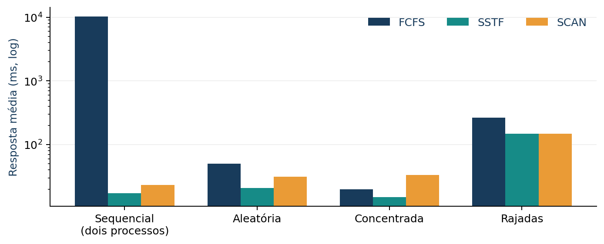
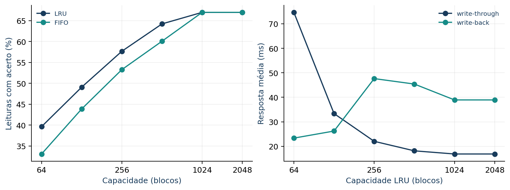

# Relatório — SimES: simulador de E/S e de sistema de arquivos

**Integrantes:** Pedro Rocha Idalencio

**Repositório:** https://github.com/Idalencio/T2-SISOP

## 0. Resumo

O SimES simula como uma operação de arquivo chega ao disco. Foram implementados os escalonadores, os custos de CPU, as operações de arquivos, cache, métodos de alocação e armazenamento flash. Os testes passaram e foram executadas 118 configurações. Os resultados mostraram três pontos principais: organizar a fila pode reduzir bastante a espera; ter espaço livre não garante que um arquivo consiga crescer; e a cache reduz acessos, mas nem sempre melhora todos os tempos.

## 1. Escopo realizado

| Parte | Situação | Observação |
|---|---|---|
| N1 · Dispositivo | usado | HDD fornecido. |
| N2 · E/S | completo | SSTF, SCAN, polling e interrupção. |
| N3 · Arquivos | completo | Caminhos, operações e tabelas de aberturas. |
| N4 · Experimentos | completo | X1 a X5. |
| M1 · Cache | completo | LRU, FIFO e políticas de escrita; X6. |
| M2 · Escalonamento avançado | completo | C-SCAN, LOOK, C-LOOK e DEADLINE; X7. |
| M6 · Alocação | completo | Encadeada, FAT e indexada; X11. |
| Integração | completo | Arquivos, cache e escalonador; X12. |
| Bônus flash | completo | Tradução de páginas e coleta de lixo; X13. |

Testes: **35 aprovados e quatro pulados**, referentes a M3, M4 e M5, que não foram escolhidos. Resultado completo em `resultados/testes.txt`.

## 2. Implementação

### N2 — Subsistema de E/S

**Onde:** `simes/es/escalonadores.py` e `simes/es/cpu.py`.

**Decisões:** SSTF escolhe o pedido mais próximo. SCAN segue uma direção e vai até a borda antes de voltar. Nos empates, vence quem chegou primeiro. Polling ocupa a CPU durante todo o atendimento; interrupção custa 0,017 ms por bloco.

**Dificuldades:** Contar a ida à borda no SCAN. Sem isso, ele acabaria funcionando como LOOK.

### N3 — Sistema de arquivos

**Onde:** `simes/arquivos/sistema.py`.

**Decisões:** Os caminhos são resolvidos lendo os diretórios. Cada abertura guarda modo e posição próprios; a tabela global conta quantas aberturas existem para o arquivo. Excluir um arquivo aberto remove o nome, mas seus blocos só são liberados no último close.

**Dificuldades:** Evitar leituras duplicadas de diretório e não liberar blocos que ainda estão sendo usados. Também foi tratado o erro de falta de espaço, sem deixar arquivos criados pela metade.

### M1 — Cache de blocos

**Onde:** `simes/es/cache.py`.

**Decisões:** LRU considera o uso mais recente; FIFO considera a ordem de entrada. Write-through encaminha a escrita ao disco na hora. Write-back mantém na memória o bloco alterado, chamado de sujo, e grava depois.

**Dificuldades:** Preservar a marca de bloco sujo e gravar uma vítima antes de descartá-la.

### M2 — Escalonamento avançado

**Onde:** `simes/es/escalonadores.py`.

**Decisões:** LOOK evita ir à borda sem necessidade. C-SCAN e C-LOOK atendem subindo. DEADLINE prioriza o prazo vencido mais antigo; sem vencidos, usa SSTF. Os prazos são 200 ms para leitura e 2.000 ms para escrita.

**Dificuldades:** Contar os retornos e entender que o prazo dá prioridade, sem garantir uma conclusão dentro daquele tempo.

### M6 — Alocação em disco

**Onde:** `simes/arquivos/alocacao.py`.

**Decisões:** Na encadeada, o acesso segue os ponteiros dos blocos. Na FAT, esses ponteiros ficam na memória. Na indexada, até 1.024 blocos é usado um índice; acima disso, são usados dois níveis. A contígua fornecida foi mantida.

**Dificuldades:** Cobrar os acessos extras de ponteiros e índices e liberar todos os blocos. A mudança de 1.024 para 1.025 blocos foi testada.

### Integração e flash

**Onde:** `simes/integracao.py`, `simes/disco.py` e `experimentos_extras.py`.

**Decisões:** A integração transforma o histórico de arquivos em pedidos de E/S, preservando os instantes. No flash, sobrescrever um endereço grava uma nova página e invalida a antiga. A coleta copia as páginas válidas antes de apagar um bloco inteiro.

**Dificuldades:** Contar as cópias da coleta como gravações físicas, sem contá-las como novas escritas pedidas pelo usuário.

## 3. Experimentos

Foram mantidos os parâmetros e as cargas oficiais. As hipóteses foram registradas antes da execução em `HIPOTESES.md`. Os resultados completos estão nos CSVs; as tabelas abaixo destacam os números usados na análise. P95 é o tempo abaixo do qual ficaram 95% das respostas.

### X1 — Escalonadores sob quatro padrões de carga

**Hipótese:** SSTF e SCAN devem reduzir deslocamento e resposta em cargas aleatórias ou concentradas sob fila. Na carga sequencial, a vantagem deve diminuir; SSTF pode aumentar a maior espera.

**Fundamentação:** Silberschatz, seção 10.4: mudar a ordem da fila pode diminuir a busca, mas também muda quem espera mais.

**Configuração:** Quatro cargas de 2.000 pedidos de oito blocos, com FCFS, SSTF e SCAN no HDD.

**Resultados:**

| Carga | FCFS (ms) | SSTF (ms) | SCAN (ms) |
|---|---|---|---|
| sequencial | 10.241,05 | 17,39 | 23,21 |
| aleatoria | 50,10 | 20,99 | 31,53 |
| concentrada | 19,80 | 15,02 | 33,20 |
| rajadas | 266,97 | 147,49 | 148,62 |

Na aleatória, SSTF reduziu o deslocamento de 3.316.472 para 2.631.714 cilindros e o P95 de 145,09 para 48,61 ms. A vazão ficou em 82,45 req/s.

**Evidências:** `resultados/es.csv` (X1); `graficos/R_X1_resposta.png`.

**Análise:** SSTF teve a menor média, mas na concentrada sua maior espera foi 130,52 ms, contra 96,02 do FCFS. SCAN piorou nessa carga porque paga a ida à borda. O grande ganho na sequencial tem uma explicação: ela alterna dois processos em regiões distantes. Ser sequencial para cada processo não significa que a fila inteira esteja em sequência.

**Veredito:** PARCIALMENTE CONFIRMADA

### X2 — Polling × interrupção conforme o dispositivo

**Hipótese:** No HDD, interrupção deve usar muito menos CPU que polling. No dispositivo rápido, a diferença diminui e o custo fixo por bloco pode tornar interrupção mais cara que espera ocupada durante o atendimento.

**Fundamentação:** Silberschatz, seções 13.2.1 e 13.2.2: polling mantém a CPU verificando o dispositivo; interrupção cobra um custo por atendimento.

**Configuração:** FCFS, cargas aleatória e sequencial, HDD e dispositivo rápido.

**Resultados:**

| Dispositivo / carga | Polling (% CPU) | Interrupção (% CPU) |
|---|---|---|
| hdd / aleatoria | 86,2832 | 1,1213 |
| hdd / sequencial | 99,9977 | 0,8361 |
| rapido / aleatoria | 0,5280 | 1,1219 |
| rapido / sequencial | 1,0739 | 2,2821 |

**Evidências:** `resultados/es.csv` (X2); `graficos/X2_cpu.png`.

**Análise:** No HDD, interrupção economizou bastante CPU. No rápido, ocorreu o contrário: oito blocos levam 0,064 ms, mas as interrupções custam 0,136 ms. O resultado depende das constantes do modelo. A CPU é contabilizada à parte e não atrasa o disco, por isso os modos tiveram a mesma resposta de E/S. Isso não basta para recomendar polling em um sistema real.

**Veredito:** CONFIRMADA

### X3 — Acesso sequencial × direto

**Hipótese:** A leitura sequencial deve aproveitar transferência de blocos vizinhos; acessos diretos devem pagar mais rotação. As médias das duas cargas também dependem dos tamanhos e das operações, portanto não isolam apenas o método de acesso.

**Fundamentação:** Silberschatz, capítulo 11: acesso sequencial avança a posição; acesso direto escolhe onde ler ou escrever.

**Configuração:** Cargas compilador e banco de dados, com alocação contígua e sem cache.

**Resultados:**

| Carga | Operação | Blocos/op | Tempo/op (ms) |
|---|---|---|---|
| compilador | read | 1,00 | 1,4828 |
| compilador | write | 1,00 | 0,9068 |
| banco_dados | read | 1,00 | 5,4918 |
| banco_dados | write | 1,00 | 5,5425 |

**Evidências:** `resultados/arquivos_por_operacao.csv` (X3); `graficos/X3_tempo_por_operacao.png`.

**Análise:** As leituras acessaram um bloco por chamada nas duas cargas, mas o compilador aproveitou melhor a sequência. No banco, as posições são aleatórias. A média geral do banco foi um pouco menor porque inclui muitos seek sem custo de disco. As cargas também têm tamanhos e operações diferentes; não se deve atribuir tudo apenas ao método de acesso.

**Veredito:** CONFIRMADA

### X4 — Custo de resolver caminhos conforme a profundidade

**Hipótese:** Cada diretório adicional deve acrescentar exatamente uma leitura por open, sem cache de diretórios. O tempo deve crescer, mas não necessariamente de forma perfeitamente linear.

**Fundamentação:** Silberschatz, capítulo 11: resolver um caminho exige consultar os diretórios até chegar ao arquivo.

**Configuração:** Um a dez diretórios de profundidade, com vinte aberturas por caminho.

**Resultados:**

| Profundidade | Leituras/open | Tempo/open (ms) |
|---|---|---|
| 1 | 2 | 4,25 |
| 5 | 6 | 4,41 |
| 10 | 11 | 4,61 |

**Evidências:** `resultados/arquivos_por_operacao.csv` (X4); `graficos/R_X4_profundidade.png`.

**Análise:** Cada nível acrescentou uma leitura. A raiz também entra na conta: dez diretórios exigiram onze leituras. O tempo cresceu pouco porque os blocos ficaram consecutivos no mesmo cilindro: 4,17 ms de rotação mais 0,04 ms por bloco. Não houve ganho ao repetir o open, pois essa camada não usa cache de diretórios.

**Veredito:** CONFIRMADA

### X5 — Tabelas de arquivos abertos com vários processos

**Hipótese:** A soma das tabelas dos processos deve superar a tabela global quando vários processos abrem os mesmos arquivos. As posições dos handles permanecem independentes e o contador global soma as aberturas.

**Fundamentação:** Silberschatz, capítulo 11: cada abertura precisa de posição e modo próprios, mesmo quando o arquivo é compartilhado.

**Configuração:** Servidor web com oito trabalhadores, doze páginas e quarenta rodadas.

**Resultados:**

| Indicador | Máximo |
|---|---|
| Tabela global | 12 |
| Tabela de um processo | 3 |
| Soma das aberturas | 24 |
| Aberturas do mesmo arquivo | 6 |

**Evidências:** `resultados/arquivos.csv` (X5); `graficos/X5_tabelas.png`.

**Análise:** As 24 aberturas correspondem a oito processos abrindo três arquivos. A tabela global chegou a doze entradas porque conta arquivos distintos. As posições não se misturam: ler por um handle não move o de outro processo. Os valores são máximos, não significam que todos os arquivos tiveram seis aberturas ao mesmo tempo.

**Veredito:** CONFIRMADA

### X6 — Cache de blocos (M1)

**Hipótese:** Aumentar a capacidade deve melhorar a taxa de acerto nesta carga com reuso. LRU deve tender a superar FIFO. Write-back deve reduzir escritas físicas, mantendo blocos sujos que podem ser perdidos na queda; write-through não mantém blocos sujos.

**Fundamentação:** Silberschatz, seções 13.4.3 e 12.6: guardar blocos usados evita repetir E/S; adiar a escrita deixa dados pendentes.

**Configuração:** 3.000 pedidos, FCFS, LRU/FIFO, seis capacidades e duas políticas de escrita. Sync a cada 5.000 ms; queda amostrada em 11.733,221 ms. A tabela destaca a LRU.

**Resultados:**

| Blocos | Escrita | Acertos (%) | Média (ms) | Escritas | Sujos na queda |
|---|---|---|---|---|---|
| 64 | write-back | 39,64 | 23,36 | 715 | 28 |
| 1024 | write-through | 67,06 | 16,89 | 1045 | 0 |
| 1024 | write-back | 67,01 | 38,93 | 541 | 55 |

**Evidências:** `resultados/es.csv` (X6); `graficos/R_X6_cache.png`.

**Análise:** LRU acertou mais que FIFO nas capacidades menores. Com 1.024 blocos, aumentar a cache não trouxe ganho. Write-back reduziu as escritas de 1.045 para 541, mas sua média ficou pior que write-through. A sincronização periódica (sync) envia lotes de gravações à fila e pode atrasar leituras. A coluna de queda conta só blocos ainda sujos na cache; não inclui toda gravação pendente nem simula uma recuperação real.

**Veredito:** CONFIRMADA

### X7 — Escalonadores avançados e inanição (M2)

**Hipótese:** Sob maior taxa de chegada, a espera tende a aumentar. DEADLINE deve limitar o adiamento de requisições antigas em comparação com SSTF quando existirem prazos vencidos; isso pode aumentar a resposta média ou o deslocamento.

**Fundamentação:** Silberschatz, seção 10.4: priorizar proximidade melhora a média, mas pode adiar pedidos distantes.

**Configuração:** Sete algoritmos, 2.000 pedidos por carga e intervalos de 14, 11, 9 e 8 ms. A tabela mostra 8 ms, equivalente a 125 req/s.

**Resultados:**

| Algoritmo | Média (ms) | Maior espera (ms) |
|---|---|---|
| SSTF | 27,78 | 327,06 |
| LOOK | 31,41 | 170,32 |
| C-LOOK | 38,92 | 163,84 |
| DEADLINE | 28,41 | 244,84 |

**Evidências:** `resultados/es.csv` (X7); `graficos/R_X7_espera.png`.

**Análise:** DEADLINE reduziu a maior espera do SSTF em cerca de 25,1%, com aumento de aproximadamente 2,3% na média. LOOK e C-LOOK esperaram menos nesse caso, mas tiveram médias maiores. Nas cargas mais leves, DEADLINE coincidiu com SSTF porque não havia prazo vencido. A carga finita mostra adiamento, sem provar inanição infinita; os 200 ms são prioridade, não um teto garantido.

**Veredito:** CONFIRMADA

### X11 — Métodos de alocação (M6)

**Hipótese:** A contígua deve ter acesso barato, mas pode falhar por fragmentação externa e realocar ao crescer. A encadeada deve pagar leituras de ponteiros no acesso direto. FAT elimina esse custo de disco ao manter a tabela em memória. A indexada troca blocos e leituras de índice por acesso limitado a um ou dois níveis.

**Fundamentação:** Silberschatz, seções 12.4 e 12.5: cada método troca facilidade de crescimento por custo de acesso e de metadados.

**Configuração:** Quatro alocadores, mesma carga de 2.468 operações e partição de 20.000 blocos.

**Resultados:**

| Alocador | Acessos/op | Tempo/op (ms) | Falhas |
|---|---|---|---|
| contigua | 7,35 | 34,55 | 113 |
| encadeada | 77,52 | 12,73 | 0 |
| fat | 1,90 | 4,01 | 0 |
| indexada | 4,29 | 14,32 | 0 |

A contígua terminou com 2.052 blocos livres em cinquenta trechos; o maior tinha 154. Houve 59 realocações.

**Evidências:** `resultados/arquivos.csv` (X11); `resultados/arquivos_por_operacao.csv` (X11); `graficos/X11_fragmentacao.png`.

**Análise:** As falhas da contígua ocorreram na extensão: havia espaço livre total, mas faltava um trecho contínuo grande. FAT foi favorecida porque os ponteiros ficam em RAM sem custo de memória ou CPU no modelo. A encadeada fez mais acessos que a indexada, mas foi mais rápida: várias leituras eram consecutivas. Como algumas escritas da contígua falharam, os tempos não representam a mesma quantidade de dados concluídos.

**Veredito:** PARCIALMENTE CONFIRMADA

### X12 — Integração ponta a ponta

**Hipótese:** A cache deve absorver metadados repetidos e reduzir a resposta. A indexada deve gerar mais requisições sem cache. O efeito do escalonador depende da fila que a carga realmente produz.

**Fundamentação:** As camadas se ligam: diretórios e índices geram pedidos de blocos, tratados pela cache e pelo escalonador. Base: Silberschatz, seções 10.4, 12.4 e 13.4.3.

**Configuração:** Duas cargas, duas alocações, três escalonadores e cache ausente ou LRU de 1.024 blocos: 24 execuções. A tabela resume FCFS.

**Resultados:**

| Carga + alocação | Sem cache (ms) | Com cache (ms) | Acertos (%) |
|---|---|---|---|
| compilador+contigua | 4.970,86 | 0,23 | 90,40 |
| compilador+indexada | 14.961,01 | 0,17 | 95,73 |
| banco_dados+contigua | 6.158,75 | 2.151,29 | 4,93 |
| banco_dados+indexada | 22.146,10 | 765,05 | 74,51 |

**Evidências:** `resultados/es.csv` (X12); `graficos/R_X12_integracao.png`.

**Análise:** A cache ajudou bastante o compilador e os índices repetidos. No banco contíguo, os dados aleatórios excedem sua capacidade e os acertos ficaram perto de 4,9%. A média é por requisição. A indexada acrescenta muitos pedidos baratos de índice, o que aumenta a quantidade de pedidos usada na conta. Por isso, média menor não prova que a operação inteira ficou mais rápida. A integração reapresenta os instantes do histórico, sem reproduzir todas as dependências reais entre chamadas.

**Veredito:** CONFIRMADA

### X13 — Armazenamento flash (bônus)

**Hipótese:** Flash deve responder mais rapidamente nas cargas aleatórias, por não pagar busca e rotação. A amplificação de escrita só deve ultrapassar 1 quando houver coleta de lixo com cópia de páginas válidas; as cargas oficiais podem não preencher o dispositivo.

**Fundamentação:** O flash não paga busca ou rotação, mas só pode programar páginas apagadas. A coleta pode exigir cópias antes de apagar um bloco. Base: capítulo 10 e modelo do bônus.

**Configuração:** FCFS, sem cache, cargas reuso e aleatória. No oficial, 320.000 páginas lógicas e 342.400 físicas. Leitura: 0,025 ms/página; programação: 0,2 ms/página; apagamento: 1,5 ms por bloco de 64 páginas.

**Resultados:**

| Carga | HDD (ms) | Flash (ms) |
|---|---|---|
| reuso | 3.499,9548 | 0,0867 |
| aleatoria | 50,1041 | 0,6443 |

A amplificação de escrita é o total de gravações físicas dividido pelas gravações pedidas pelo usuário.

Teste extra: preenchimento de 4.096 páginas lógicas, seguido de 16.384 sobrescritas; semente 13. São 4.416 páginas físicas, com reserva efetiva de 7,8125%.

| Sobrescrita | Amplificação | Apagamentos | Tempo (ms) |
|---|---|---|---|
| sequencial | 1,0000 | 252 | 4.474,00 |
| aleatoria | 6,3436 | 1962 | 31.662,10 |

**Evidências:** `resultados/es.csv` (X13); `resultados/extra_flash_gc.csv`; `graficos/R_X13_flash_gc.png`.

**Análise:** O flash teve menor resposta, mas a vazão aleatória ficou perto de 82,49 req/s, limitada pelas chegadas. No oficial, poucas páginas foram gravadas: não houve coleta e a amplificação foi 1. No extra aleatório, 20.480 páginas do usuário causaram 129.916 programações, incluindo 109.436 cópias. A razão foi 6,3436. O tempo confere: 129.916 × 0,2 + 109.436 × 0,025 + 1.962 × 1,5 = 31.662,10 ms. Na sequência, blocos inteiros ficaram inválidos e não foi preciso copiar sobreviventes.

**Veredito:** CONFIRMADA

## 4. Relação com sistemas reais

**Linux.** O mq-deadline também usa prazos, mas trabalha com lotes e preferência por leitura. BFQ busca distribuir o acesso entre aplicações. Isso ajuda a entender a diferença entre melhorar a média e evitar espera alta em X1 e X7. A dentry cache reduz consultas repetidas de caminhos, diferente de X4. O ext4 agrupa blocos em trechos (extents) e pode adiar a escolha de onde gravá-los, diferente do índice simples do exercício. Fontes: R1 a R4.

**Windows.** O Cache Manager usa escrita adiada, relacionada ao que X6 mostra com write-back. Há formas de pedir gravação imediata, como write-through e FlushFileBuffers. No NTFS, a Tabela Mestre de Arquivos (MFT) guarda registros dos arquivos, diferente de manter uma FAT em RAM. Isso muda o custo de metadados comparado a X11 e X12. Fontes: R5 e R6.

**macOS.** O APFS permite cópias que compartilham blocos (clones) e grava as alterações em outros locais. Esse comportamento difere de simplesmente copiar todo o arquivo ou guardar um bloco na cache. Sua organização considera armazenamento flash, mas tem estruturas e garantias que o bônus não reproduz. Fontes: R7 e R8.

Os três sistemas usam outras camadas e otimizações. Portanto, os tempos do SimES servem para explicar os mecanismos, não para prever o desempenho desses sistemas.

## 5. Limitações do simulador

- O HDD usa custos fixos; o flash não inclui desgaste, TRIM ou canais paralelos.
- Há apenas um atendimento de disco por vez. O custo de CPU é somado à parte, sem atrasar a fila.
- A cache não mede toda a perda de uma queda real: o sync pode marcar blocos limpos antes da conclusão física, e não há recuperação após falha.
- Na integração, a média é por pedido de bloco e os instantes são reapresentados sem todas as dependências das operações.
- A FAT não paga custo de RAM ou CPU. A contígua teve escritas que falharam, então os alocadores não concluíram quantidades iguais de dados.
- As cargas têm sementes fixas. A comparação com sistemas reais usa documentação, sem medições nativas nesses sistemas.

## 6. Conclusões

- SSTF melhorou a média, mas alguns pedidos esperaram mais. DEADLINE reduziu parte desse adiamento.
- A cache evitou acessos e escritas repetidas. Os lotes do sync explicam por que write-back nem sempre teve menor resposta.
- Espaço livre total não garante crescimento contíguo. A posição e a ordem dos acessos também importam, além da quantidade de blocos lidos.
- Flash eliminou busca e rotação. Quando a coleta precisou copiar páginas válidas, o total de gravações físicas aumentou bastante.

## 7. Referências

- SILBERSCHATZ, A.; GALVIN, P. B.; GAGNE, G. *Operating System Concepts*. 9. ed. Wiley, 2013. Capítulos 10 a 13. Material dos autores: https://www.os-book.com/OS9/slide-dir/ .
- R1. LINUX KERNEL. *Deadline IO scheduler tunables* e *BFQ*. https://docs.kernel.org/block/deadline-iosched.html ; https://docs.kernel.org/block/bfq-iosched.html .
- R2. LINUX KERNEL. *Overview of the Linux Virtual File System*. https://docs.kernel.org/filesystems/vfs.html .
- R3. LINUX KERNEL. *The Contents of inode.i_block*. https://docs.kernel.org/filesystems/ext4/ifork.html .
- R4. LINUX KERNEL. *Block and Inode Allocation Policy*. https://docs.kernel.org/filesystems/ext4/allocators.html .
- R5. MICROSOFT. *File Caching*. https://learn.microsoft.com/en-us/windows/win32/fileio/file-caching .
- R6. MICROSOFT. *Master File Table*. https://learn.microsoft.com/en-us/windows/win32/fileio/master-file-table .
- R7. APPLE. *About Apple File System*. https://developer.apple.com/documentation/foundation/about-apple-file-system .
- R8. APPLE. *Apple File System Guide: FAQ*. Documento arquivado. https://developer.apple.com/library/archive/documentation/FileManagement/Conceptual/APFS_Guide/FAQ/FAQ.html .
- MÓR, Filipo Novo. *SimES: enunciado e código-base*. PUCRS, 2026/II. https://github.com/ProfessorFilipo/Aulas_SisOp/tree/main/Trabalho_IO_2026II .

## 8. Declaração de autoria e uso de IA

**Quem fez o quê:** Pedro Rocha Idalencio — trabalho individual.

**Uso de ferramentas de IA:**

| Ferramenta | Finalidade | Onde foi usada (arquivos ou seções) |
|---|---|---|
| ChatGPT/Codex | Apoio à implementação e à escrita do relatório. | Implementação do simulador e scripts associados; RELATORIO.md. |
