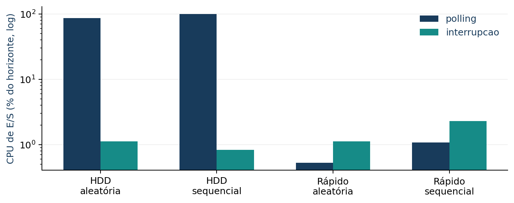
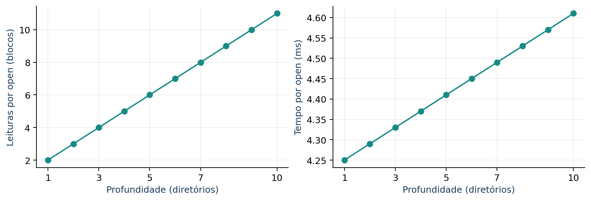
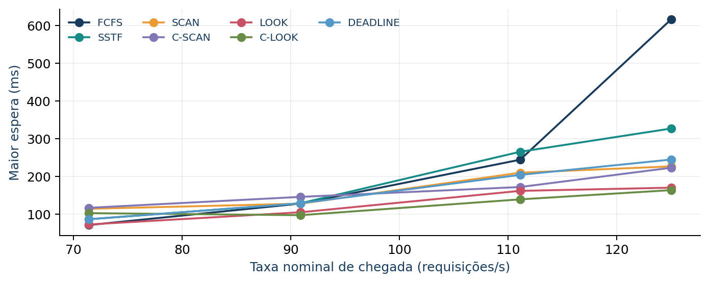
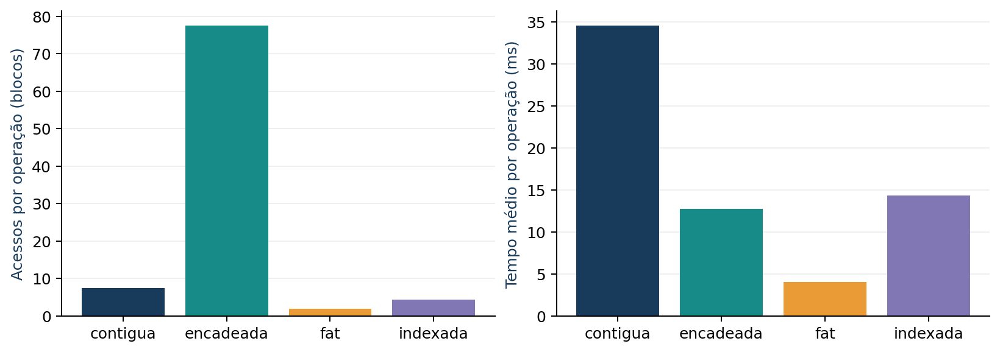
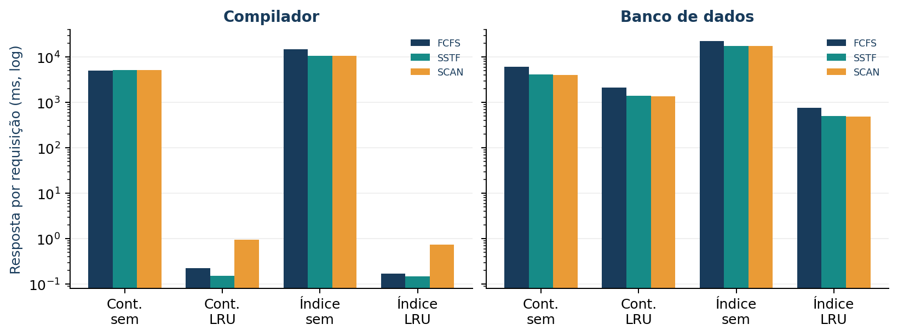
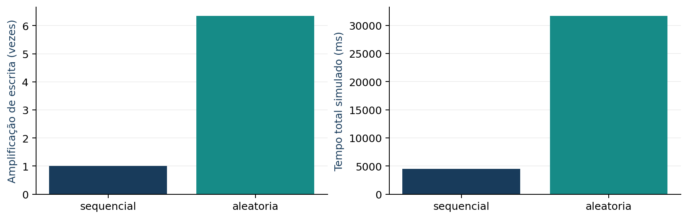

# Relatório — SimES: simulador de E/S e de sistema de arquivos

**Integrantes:** Pedro Rocha Idalencio

**Repositório:** https://github.com/Idalencio/T2-SISOP

Sistemas Operacionais · PUCRS · 2026/II · Prof. Filipo Novo Mór

## 0. Resumo

O SimES foi completado com o núcleo, cache (M1), escalonamento avançado (M2), alocação (M6), integração e armazenamento flash. Foram executadas 118 configurações oficiais, distribuídas em dez experimentos. Na carga sequencial com dois processos distantes, a resposta média caiu de 10.241,05 ms no FCFS para 17,39 ms no SSTF. A contígua teve 113 falhas de extensão, mesmo terminando com 2.052 blocos livres. No flash oficial, a amplificação foi 1, sem coleta; no teste extra com sobrescritas aleatórias, chegou a 6,34. Menos movimento ou menos acessos ao disco nem sempre significaram menor tempo de resposta.

## 1. Escopo realizado

| Parte | Situação | Observação |
|---|---|---|
| N1 · Dispositivo (fornecido) | usado | Modelo HDD e parâmetros preservados. |
| N2 · Subsistema de E/S (SSTF, SCAN, polling, interrupção) | completo | Empates por ordem de chegada e custo de CPU conforme o modelo. |
| N3 · Sistema de arquivos | completo | Operações, caminhos, posições, tabelas e unlink com arquivo aberto. |
| N4 · Experimentos X1–X5 e relatório | completo | CSVs, gráficos e análise com hipóteses prévias. |
| M1 · Cache de blocos | completo | LRU, FIFO, write-through e write-back; X6. |
| M2 · Escalonamento avançado | completo | C-SCAN, LOOK, C-LOOK e DEADLINE; X7. |
| M6 · Alocação em disco | completo | Encadeada, FAT e indexada de dois níveis; X11. |
| Integração | completo | Histórico de arquivos convertido em E/S; X12. |
| Bônus flash | completo | FTL, páginas, coleta, apagamento e amplificação; X13 e extra. |

A entrega é individual. Além do núcleo obrigatório, foram feitos M1, M2, M6, integração e bônus, com os respectivos experimentos. M3, M4 e M5 ficaram fora do escopo.

Resultado dos testes automáticos (`python3 executar.py testes`): **Ran 39 tests; OK (skipped=4)**. São 35 testes aprovados e quatro pulados, todos de módulos não escolhidos. Os testes originais foram preservados; 13 testes adicionais cobrem fronteiras e invariantes. Evidência: `resultados/testes.txt`.

Os 30 arquivos protegidos conferidos coincidem com a base oficial. Uma segunda execução reproduziu os cinco CSVs oficiais byte a byte. Evidências: `resultados/integridade_base.json` e `resultados/reproducibilidade.json`. A execução foi feita em Linux com Python; a sintaxe foi conferida para Python 3.8. Windows e macOS não foram executados nesta sessão.

## 2. Implementação

### N2 — Subsistema de E/S

**Onde:** `simes/es/escalonadores.py` e `simes/es/cpu.py`.

**Decisões:** SSTF escolhe a menor distância e, no empate, preserva a ordem da fila. SCAN atende na direção atual; ao faltar trabalho à frente, devolve a borda em `passar_por` e inverte. A requisição no cilindro atual fica à frente nas duas direções. A borda é contabilizada pelo disco, sem inventar um atendimento extra. Polling custa a duração inteira do serviço; interrupção custa `n_blocos × (0,015 + 0,002)` ms. Para oito blocos, são 0,136 ms de CPU, independentemente da busca e da rotação.

**Dificuldades:** É fácil implementar LOOK no lugar de SCAN e esquecer a ida à borda. O teste do livro verifica ordem e deslocamento: SSTF soma 236 cilindros; SCAN soma 236 descendo e 331 subindo. O custo computacional da busca na fila não entra nos indicadores de CPU: estes seguem apenas a fórmula fornecida.

### N3 — Sistema de arquivos

**Onde:** `simes/arquivos/sistema.py`.

**Decisões:** `resolver` lê cada diretório atravessado. A rotina de criação resolve o pai e lê seu bloco uma única vez antes de alterar a entrada. Um diretório novo recebe um bloco; o `create` reserva dados sem gravar seu conteúdo. As leituras param no tamanho do arquivo. Escritas estendem apenas quando necessário e marcam o FCB como sujo; o `close` grava o diretório pai se houver metadados pendentes. O modo `w` segue a regra didática, sem truncamento implícito. No modo `a`, cada escrita consulta novamente o fim do arquivo, mesmo depois de um `seek`.

Cada abertura cria uma entrada do processo com modo e posição próprios. A tabela global mantém uma entrada por FCB e soma as aberturas. O `unlink` remove a entrada de diretório e decrementa os links. Com handles abertos, os blocos permanecem reservados até o último `close`. `seek` e operações de zero bytes não geram E/S de dados. Valores inválidos e modos incompatíveis produzem `ErroSA`.

**Dificuldades:** Não duplicar leituras na resolução do pai e não liberar um arquivo ainda aberto. Também foi tratado o erro de alocação: um `create` sem espaço não deixa FCB órfão nem nome no diretório. Os testes adicionais verificam três handles distribuídos entre dois processos e extensão sem espaço.

### M1 — Cache de blocos

**Onde:** `simes/es/cache.py`.

**Decisões:** `OrderedDict` guarda bloco e estado sujo. LRU move o bloco para o fim a cada acesso; FIFO conserva a ordem de entrada. Uma reinserção preserva o estado sujo. No write-through, a escrita devolve o próprio bloco para gravação imediata; no write-back, devolve somente vítimas sujas. `sincronizar` devolve os blocos sujos e os marca como limpos, conforme a interface fornecida. Capacidade não positiva é rejeitada.

**Dificuldades:** Separar substituição, política de escrita e emissão da gravação física. A cache apenas informa os blocos; o simulador fornecido enfileira a E/S. Isso é importante para interpretar a medição de perda na queda, que não acompanha persistência física completa.

### M2 — Escalonamento avançado

**Onde:** `simes/es/escalonadores.py`.

**Decisões:** C-SCAN sobe, passa pela borda superior e retorna a zero; o retorno conta. LOOK inverte no último pedido disponível. C-LOOK salta ao menor cilindro quando acaba o trabalho à frente. DEADLINE atende o menor prazo vencido; sem vencidos, usa SSTF. Os prazos vêm da requisição: 200 ms para leitura e 2.000 ms para escrita. Empates mantêm a ordem da fila.

**Dificuldades:** O prazo é uma regra de prioridade, não uma garantia rígida de conclusão. O algoritmo didático segue o contrato do professor e não reproduz integralmente o mq-deadline do Linux.

### M6 — Alocação em disco

**Onde:** `simes/arquivos/alocacao.py`.

**Decisões:** A contígua fornecida foi mantida. Encadeada reserva os primeiros blocos livres e conserva um cursor por arquivo. Saltar para trás reinicia a corrente; seguir para o próximo bloco não exige leituras extras. FAT mantém os ponteiros em memória e não cobra E/S para consultá-los. A indexada reserva índices antes dos dados. Até 1.024 blocos, usa um índice; acima disso, usa um primeiro nível e os índices do segundo. A extensão reserva dados e índices em conjunto, evitando uma alteração parcial quando ocorre `ENOSPC`. A liberação devolve ambos.

**Dificuldades:** Cobrar as leituras e escritas extras exatamente no local definido pelo modelo. A passagem de 1.024 para 1.025 blocos foi testada, inclusive a liberação de todos os índices. O modelo não cobra RAM nem tempo de CPU para consultar a FAT; essa vantagem precisa aparecer como limitação da comparação.

### Integração e bônus flash

**Onde:** `simes/integracao.py`, `simes/disco.py` e `experimentos_extras.py`.

**Decisões:** O histórico é ordenado de forma estável por instante, e os IDs são atribuídos depois da ordenação. Acessos da mesma operação mantêm o instante e a ordem original. No flash, um mapa liga páginas lógicas às físicas. Sobrescrever invalida a página antiga e programa uma apagada. A coleta escolhe um bloco com muitas páginas inválidas, copia as válidas para fora da vítima e apaga o bloco inteiro. O tempo inclui leitura e programação das cópias e apagamento. As cópias aumentam `paginas_programadas`, sem aumentar `paginas_gravadas_host`.

**Dificuldades:** Não usar páginas da própria vítima como destino da coleta e manter espaço para copiar as sobreviventes. A capacidade física é arredondada por blocos apagáveis, com pelo menos um bloco de reserva. No dispositivo oficial, são 320.000 páginas lógicas e 342.400 físicas, exatamente 7% de reserva sobre a capacidade lógica. O teste extra usa 4.096 e 4.416, respectivamente: 7,8125% após arredondamento.

## 3. Experimentos

As hipóteses completas estão em `HIPOTESES.md`, criado no commit local `046c2d1` antes da implementação e da primeira execução. Nenhuma foi reescrita para coincidir com os resultados. Os parâmetros, as cargas oficiais e `experimentos.py` foram preservados. Os números abaixo vêm dos CSVs; arredondamentos de apresentação não alteram esses arquivos. Em X1, X2, X6, X7, X12 e X13, resposta inclui espera na fila. Em X3 a X5 e X11, o tempo é custo de disco por operação, sem uma fila de E/S concorrente.

### X1 — Escalonadores sob quatro padrões de carga

**Hipótese:** SSTF e SCAN devem reduzir deslocamento e resposta em cargas aleatórias ou concentradas sob fila. Na carga sequencial, a vantagem deve diminuir; SSTF pode aumentar a maior espera.

**Fundamentação:** Silberschatz, seção 10.4: ordenar a fila pode reduzir a busca, mas a ordem de atendimento também afeta a espera de cada pedido. A regra do HDD separa busca, rotação e transferência.

**Configuração:** 2.000 requisições de oito blocos por carga; FCFS, SSTF e SCAN, HDD e interrupção. A carga chamada sequencial intercala dois processos, em regiões distantes, e tem intervalo médio de chegada de 6 ms; aleatória e concentrada usam 12 ms. Rajadas têm 50 pedidos simultâneos a cada 600 ms.

**Resultados:**

| Carga | Algoritmo | Braço (cil.) | Média (ms) | P95 (ms) | Espera máx. (ms) | Vazão (req/s) |
|---|---|---|---|---|---|---|
| sequencial | FCFS | 7.184.093 | 10.241,05 | 19.565,45 | 20.598,06 | 61,48 |
| sequencial | SSTF | 2.336.365 | 17,39 | 32,79 | 37,44 | 167,49 |
| sequencial | SCAN | 2.469.069 | 23,21 | 43,65 | 48,59 | 167,41 |
| aleatoria | FCFS | 3.316.472 | 50,10 | 145,09 | 193,52 | 82,45 |
| aleatoria | SSTF | 2.631.714 | 20,99 | 48,61 | 116,65 | 82,45 |
| aleatoria | SCAN | 3.372.680 | 31,53 | 65,06 | 116,73 | 82,36 |
| concentrada | FCFS | 1.864.164 | 19,80 | 48,57 | 96,02 | 83,81 |
| concentrada | SSTF | 1.613.030 | 15,02 | 37,20 | 130,52 | 83,81 |
| concentrada | SCAN | 3.338.708 | 33,20 | 68,33 | 118,75 | 83,70 |
| rajadas | FCFS | 3.341.490 | 266,97 | 505,32 | 597,29 | 83,46 |
| rajadas | SSTF | 209.811 | 147,49 | 277,72 | 296,99 | 84,42 |
| rajadas | SCAN | 199.955 | 148,62 | 278,70 | 285,44 | 84,42 |

**Evidências:** `resultados/es.csv` (experimento=X1); `graficos/X1_resposta_media_ms.png`; `graficos/X1_deslocamento_total.png`; `graficos/R_X1_resposta.png`.

**Análise:** SSTF foi o melhor na média das quatro cargas, mas isso não quer dizer que ele sempre atende todos de forma justa. Na concentrada, a média caiu de 19,80 para 15,02 ms, enquanto a maior espera aumentou de 96,02 para 130,52 ms. Um pedido distante pode esperar mais enquanto outros, mais próximos, são atendidos.

SCAN não melhorou tudo: na concentrada, a média chegou a 33,20 ms. A ida até a borda custa tempo mesmo quando não há pedidos naquela região. Na aleatória, ele melhorou a resposta, mas percorreu mais cilindros que FCFS.

O maior ganho apareceu na carga sequencial, contrariando parte da hipótese. Ela intercala dois processos em regiões distantes: um começa no bloco 20.000 e outro no 250.000. FCFS fica cruzando o disco; SSTF agrupa pedidos próximos. Além disso, essa carga tem chegada mais intensa. Portanto, ela não representa uma única leitura sequencial isolada. Nas rajadas, vários pedidos já chegam juntos e a ordenação espacial funciona bem. Essa troca entre média e espera ajuda a entender a existência de políticas distintas no Linux; não identifica o algoritmo usado por Windows ou macOS.

**Veredito:** PARCIALMENTE CONFIRMADA

### X2 — Polling × interrupção conforme o dispositivo

**Hipótese:** No HDD, interrupção deve usar muito menos CPU que polling. No dispositivo rápido, a diferença diminui e o custo fixo por bloco pode tornar interrupção mais cara que espera ocupada durante o atendimento.

**Fundamentação:** Silberschatz, seções 13.2.1 e 13.2.2. Polling ocupa CPU enquanto aguarda; interrupção evita essa espera ocupada, mas tem custo de tratamento e cópia por bloco.

**Configuração:** FCFS, duas cargas, dois dispositivos e dois modos de CPU: oito execuções. O dispositivo rápido transfere em 0,008 ms/bloco e não paga busca nem rotação. O percentual divide o custo acumulado de CPU pelo horizonte simulado, incluindo períodos ociosos.

**Resultados:**

| Dispositivo / carga | Polling (%) | Interrupção (%) |
|---|---|---|
| hdd / aleatoria | 86,2832 | 1,1213 |
| hdd / sequencial | 99,9977 | 0,8361 |
| rapido / aleatoria | 0,5280 | 1,1219 |
| rapido / sequencial | 1,0739 | 2,2821 |

**Evidências:** `resultados/es.csv` (experimento=X2); `graficos/X2_cpu.png`; `graficos/R_X2_cpu.png`.

**Análise:** No HDD, interrupção consumiu muito menos CPU. Na carga aleatória, foram 1,1213%, contra 86,2832% de polling. A CPU deixa de passar o tempo inteiro verificando se o disco terminou.

No dispositivo rápido aconteceu o contrário. O serviço de oito blocos leva 0,064 ms, mas a fórmula da interrupção cobra 0,136 ms de CPU. A espera ocupada fica mais barata com essas constantes. Isso explica o resultado do simulador; não é uma recomendação para trocar drivers reais por polling.

Os dois modos deram a mesma resposta de E/S porque o custo de CPU é contabilizado à parte e não atrasa o disco. Linux, Windows e macOS têm outros mecanismos, como DMA e tratamento de várias conclusões, que essa comparação não inclui. O contador de deslocamento do dispositivo rápido também é apenas um atributo herdado do modelo HDD, sem custo de busca.

**Veredito:** CONFIRMADA

### X3 — Acesso sequencial × direto

**Hipótese:** A leitura sequencial deve aproveitar transferência de blocos vizinhos; acessos diretos devem pagar mais rotação. As médias das duas cargas também dependem dos tamanhos e das operações, portanto não isolam apenas o método de acesso.

**Fundamentação:** Silberschatz, capítulo 11: acesso sequencial avança a posição; acesso direto seleciona a posição. No HDD fornecido, um bloco imediatamente seguinte evita nova latência rotacional.

**Configuração:** Cargas compilador e banco_dados, alocação contígua, sem cache nem fila concorrente. Cada chamada read/write da tabela abaixo acessa um bloco, em média. A média geral inclui também open, close, create e seek.

**Resultados:**

| Carga | Operação | Chamadas | Blocos/op | Tempo/op (ms) |
|---|---|---|---|---|
| compilador | open | 600 | 3,00 | 8,2049 |
| compilador | read | 1719 | 1,00 | 1,4828 |
| compilador | write | 726 | 1,00 | 0,9068 |
| banco_dados | open | 2 | 2,00 | 4,2500 |
| banco_dados | read | 2405 | 1,00 | 5,4918 |
| banco_dados | write | 1190 | 1,00 | 5,5425 |

**Evidências:** `resultados/arquivos.csv` (experimento=X3); `resultados/arquivos_por_operacao.csv` (experimento=X3); `graficos/X3_tempo_por_operacao.png`.

**Análise:** Cada read acessou um bloco, em média, nas duas cargas. Mesmo assim, a leitura custou 1,4828 ms no compilador e 5,4918 ms no banco. A diferença vem da ordem e da localização dos blocos: o compilador aproveita a sequência; o banco acessa posições aleatórias de uma tabela de 64 MiB.

Olhando só a média geral, o banco parece um pouco mais rápido: 3,0062 ms/op, contra 3,0704 do compilador. Mas essa média inclui operações diferentes. O banco faz muitos seek, que custam zero acessos, e mantém os arquivos abertos. O compilador faz 600 open, cada um com três leituras de diretório.

Por isso, a comparação por operação é mais útil que a média geral. As cargas também diferem em tamanho e quantidade de operações, então não isolam apenas o método de acesso. Nos três sistemas reais discutidos na seção 4, cache e antecipação de leitura podem reduzir parte desses custos.

**Veredito:** CONFIRMADA

### X4 — Custo de resolver caminhos conforme a profundidade

**Hipótese:** Cada diretório adicional deve acrescentar exatamente uma leitura por open, sem cache de diretórios. O tempo deve crescer, mas não necessariamente de forma perfeitamente linear.

**Fundamentação:** Silberschatz, capítulo 11, diretórios hierárquicos. Pela regra de resolver, cada componente intermediário exige ler o diretório que contém o próximo nome.

**Configuração:** Profundidades de um a dez diretórios; vinte aberturas por profundidade, com alocação contígua e sem cache de diretórios. A raiz também é lida, logo são d+1 leituras para abrir o arquivo no fim de d diretórios.

**Resultados:**

| Profundidade | Aberturas | Leituras/open | Tempo/open (ms) |
|---|---|---|---|
| 1 | 20 | 2 | 4,2500 |
| 2 | 20 | 3 | 4,2900 |
| 3 | 20 | 4 | 4,3300 |
| 4 | 20 | 5 | 4,3700 |
| 5 | 20 | 6 | 4,4100 |
| 6 | 20 | 7 | 4,4500 |
| 7 | 20 | 8 | 4,4900 |
| 8 | 20 | 9 | 4,5300 |
| 9 | 20 | 10 | 4,5700 |
| 10 | 20 | 11 | 4,6100 |

**Evidências:** `resultados/arquivos_por_operacao.csv` (experimento=X4, operacao=open); `graficos/X4_open_por_profundidade.png`; `graficos/R_X4_profundidade.png`.

**Análise:** Cada nível acrescentou uma leitura, exatamente como esperado. A raiz também entra na conta: um arquivo abaixo de dez diretórios exige onze leituras no open.

O tempo aumentou pouco porque, nessa carga, os diretórios ficaram em blocos consecutivos do mesmo cilindro. O custo é 4,17 ms de rotação mais 0,04 ms por bloco: 4,17 + 0,04 × (d+1). Isso dá 4,25 ms na profundidade 1 e 4,61 ms na 10.

Abrir o mesmo caminho várias vezes não diminuiu o custo, pois essa camada do simulador não tem cache de diretórios. No Linux, a dentry cache evita parte das consultas repetidas; o Windows também mantém metadados em cache. Os valores medidos não devem ser tratados como custo fixo de resolver caminhos no macOS ou nesses outros sistemas.

**Veredito:** CONFIRMADA

### X5 — Tabelas de arquivos abertos com vários processos

**Hipótese:** A soma das tabelas dos processos deve superar a tabela global quando vários processos abrem os mesmos arquivos. As posições dos handles permanecem independentes e o contador global soma as aberturas.

**Fundamentação:** Silberschatz, capítulo 11: tabelas por processo mantêm o contexto de cada abertura, enquanto informações compartilhadas podem ficar em uma tabela global.

**Configuração:** Carga servidor_web, oito processos trabalhadores, doze páginas e quarenta rodadas. Cada trabalhador abre três páginas antes da fase de leitura. Indicadores são máximos observados, não médias.

**Resultados:**

| Indicador | Máximo |
|---|---|
| Tabela global (arquivos) | 12 |
| Tabela de um processo (handles) | 3 |
| Soma das tabelas dos processos (handles) | 24 |
| Contador de aberturas de um arquivo | 6 |

Foram 6279 operações, sem erros.

**Evidências:** `resultados/arquivos.csv` (experimento=X5); `graficos/X5_tabelas.png`; `resultados/testes.txt`.

**Análise:** O máximo de 24 handles bate com os oito trabalhadores abrindo três páginas cada. A tabela global chegou a doze entradas porque ela guarda arquivos distintos, não uma cópia para cada abertura. Um mesmo arquivo chegou a ter seis aberturas.

As posições continuam separadas por handle. Ler pelo handle de um processo não avança a posição usada por outro. No close, o contador diminui; a entrada global só sai quando ele chega a zero.

Esses números são máximos de indicadores diferentes. Eles não significam que todos os doze arquivos tiveram seis aberturas ao mesmo tempo. A tabela global por FCB é uma simplificação: no Linux, duas aberturas do mesmo inode podem ter objetos de arquivo diferentes. A comparação com handles e descritores de Windows e macOS também deve respeitar essa diferença.

**Veredito:** CONFIRMADA

### X6 — Cache de blocos (M1)

**Hipótese:** Aumentar a capacidade deve melhorar a taxa de acerto nesta carga com reuso. LRU deve tender a superar FIFO. Write-back deve reduzir escritas físicas, mantendo blocos sujos que podem ser perdidos na queda; write-through não mantém blocos sujos.

**Fundamentação:** Silberschatz, seções 13.4.3 e 12.6: a localidade torna útil manter blocos em memória. Escrita adiada reduz gravações repetidas, com um intervalo de vulnerabilidade até persistir os dados.

**Configuração:** 3.000 requisições de um bloco da carga reuso; FCFS e HDD. Sem cache e com LRU/FIFO, seis capacidades de 64 a 2.048 blocos e duas políticas de escrita: 25 execuções. A amostragem de queda usa 11.733,221 ms; a sincronização periódica ocorre a cada 5.000 ms. A tabela mostra todas as capacidades da LRU; FIFO está no CSV e na figura.

**Resultados:**

| Cap. | Política | Acertos (%) | Média (ms) | Escritas físicas | Sujos na queda |
|---|---|---|---|---|---|
| 64 | write-through | 39,64 | 74,66 | 1045 | 0 |
| 64 | write-back | 39,64 | 23,36 | 715 | 28 |
| 128 | write-through | 48,85 | 33,37 | 1045 | 0 |
| 128 | write-back | 49,10 | 26,24 | 630 | 51 |
| 256 | write-through | 57,75 | 22,05 | 1045 | 0 |
| 256 | write-back | 57,70 | 47,63 | 543 | 55 |
| 512 | write-through | 64,19 | 18,17 | 1045 | 0 |
| 512 | write-back | 64,25 | 45,41 | 541 | 55 |
| 1024 | write-through | 67,06 | 16,89 | 1045 | 0 |
| 1024 | write-back | 67,01 | 38,93 | 541 | 55 |
| 2048 | write-through | 67,06 | 16,89 | 1045 | 0 |
| 2048 | write-back | 67,01 | 38,93 | 541 | 55 |

**Evidências:** `resultados/es.csv` (experimento=X6); `graficos/X6_acerto.png`; `graficos/X6_escrita.png`; `graficos/R_X6_cache.png`.

**Análise:** A cache fez bastante diferença: sem ela, a média era 3.499,95 ms. Com LRU de 64 blocos, caiu para 74,66 ms em write-through e 23,36 ms em write-back. Com 1.024 blocos, os acertos ficaram perto de 67%; aumentar para 2.048 não trouxe ganho. LRU também superou FIFO nas capacidades menores: em write-back com 64 blocos, foram 39,64% contra 33,09%.

Write-back gravou menos, mas nem sempre respondeu mais rápido. Na LRU de 1.024 blocos, fez 541 escritas, contra 1.045 do write-through, porém sua média foi 38,93 ms, acima dos 16,89 ms do write-through. O sync coloca lotes de gravações internas na mesma fila FCFS e pode atrasar leituras. A ordem das inserções também depende da conclusão das requisições.

A coluna de queda tem um limite importante: conta apenas os blocos ainda marcados como sujos, no primeiro ponto do laço que alcança o instante definido. Ela não interrompe a simulação e não soma todas as gravações pendentes. O sync marca os blocos como limpos antes da conclusão física. Assim, zero no write-through não prova que uma queda real nunca perderia dados. A seção 4 compara essa escrita adiada com os sistemas reais.

**Veredito:** CONFIRMADA

### X7 — Escalonadores avançados e inanição (M2)

**Hipótese:** Sob maior taxa de chegada, a espera tende a aumentar. DEADLINE deve limitar o adiamento de requisições antigas em comparação com SSTF quando existirem prazos vencidos; isso pode aumentar a resposta média ou o deslocamento.

**Fundamentação:** Silberschatz, seção 10.4: minimizar busca pode adiar pedidos distantes. A prioridade por prazo vencido dá espaço a pedidos antigos, com possível custo para a média.

**Configuração:** Quatro cargas geradas com 2.000 pedidos, semente 7, região quente concentrada e intervalos médios de 14, 11, 9 e 8 ms. Sete algoritmos, totalizando 28 execuções. A tabela mostra 8 ms (125 req/s); a figura inclui as quatro taxas.

**Resultados:**

| Algoritmo | Média (ms) | P95 (ms) | Espera máx. (ms) | Braço (cil.) |
|---|---|---|---|---|
| FCFS | 281,64 | 538,02 | 616,17 | 1.811.896 |
| SSTF | 27,78 | 79,57 | 327,06 | 1.150.844 |
| SCAN | 49,01 | 116,56 | 226,74 | 1.529.626 |
| C-SCAN | 65,84 | 142,06 | 223,10 | 1.589.526 |
| LOOK | 31,41 | 87,50 | 170,32 | 1.165.152 |
| C-LOOK | 38,92 | 100,20 | 163,84 | 1.258.318 |
| DEADLINE | 28,41 | 84,78 | 244,84 | 1.148.860 |

**Evidências:** `resultados/es.csv` (experimento=X7); `graficos/X7_espera_max_ms.png`; `graficos/X7_resposta_p95_ms.png`; `graficos/R_X7_espera.png`.

**Análise:** Com intervalo de 8 ms, DEADLINE diminuiu a maior espera de 327,06 para 244,84 ms em relação ao SSTF: cerca de 25,1%. A média aumentou de 27,78 para 28,41 ms, aproximadamente 2,3%. Foi a troca esperada: atender pedidos antigos pode custar um pouco da vantagem de escolher sempre o mais próximo.

Em 14 e 11 ms, DEADLINE e SSTF deram os mesmos números. A espera não chegou aos 200 ms das leituras nem aos 2.000 ms das escritas, então a regra de prazo não precisou mudar a escolha.

DEADLINE não ganhou em tudo. Em 8 ms, LOOK e C-LOOK tiveram maior espera de 170,32 e 163,84 ms, mas médias superiores. FCFS chegou a 281,64 ms de média; SCAN e C-SCAN pagaram as viagens à borda.

A carga é finita, então o teste mostra adiamento, sem demonstrar inanição infinita. Os 200 ms também não são uma garantia rígida: o disco precisa terminar o serviço atual antes de escolher outro. O algoritmo didático não reproduz todo o mq-deadline do Linux nem permite concluir a política de Windows ou macOS.

**Veredito:** CONFIRMADA

### X11 — Métodos de alocação (M6)

**Hipótese:** A contígua deve ter acesso barato, mas pode falhar por fragmentação externa e realocar ao crescer. A encadeada deve pagar leituras de ponteiros no acesso direto. FAT elimina esse custo de disco ao manter a tabela em memória. A indexada troca blocos e leituras de índice por acesso limitado a um ou dois níveis.

**Fundamentação:** Silberschatz, seções 12.4 e 12.5: contiguidade, encadeamento e índices trocam custo de acesso, metadados e facilidade de crescimento. O total livre e o maior trecho livre medem problemas distintos.

**Configuração:** Carga alocacao, 2.468 operações em partição de 20.000 blocos. Primeiro ocupa cerca de 70%, remove arquivos, volta a ocupar cerca de 85% e depois faz extensões e acessos. Quatro alocadores, com os mesmos pedidos. Falhas são registradas e a carga continua.

**Resultados:**

| Alocador | Blocos/op | Tempo/op (ms) | Falhas | Realocações | Livres | Maior trecho |
|---|---|---|---|---|---|---|
| contigua | 7,3545 | 34,5517 | 113 | 59 | 2052 | 154 |
| encadeada | 77,5158 | 12,7280 | 0 | 0 | 1939 | 1939 |
| fat | 1,9003 | 4,0058 | 0 | 0 | 1939 | 1939 |
| indexada | 4,2889 | 14,3215 | 0 | 0 | 1805 | 1805 |

**Evidências:** `resultados/arquivos.csv` (experimento=X11); `resultados/arquivos_por_operacao.csv` (experimento=X11); `graficos/X11_fragmentacao.png`; `graficos/R_X11_alocacao.png`.

**Análise:** A contígua teve 113 falhas de write ao tentar estender arquivos e fez 59 realocações. No fim, ainda havia 2.052 blocos livres, mas espalhados em cinquenta trechos; o maior tinha só 154. Somar espaço livre não resolve quando o arquivo precisa caber em um trecho contínuo.

A cópia dos arquivos nas realocações ajuda a explicar a média de 34,5517 ms/op, acima das demais. Também há uma ressalva: como algumas escritas falharam, os alocadores não concluíram a mesma quantidade de dados. Os tempos não representam trabalho bem-sucedido equivalente.

Encadeada fez 77,5158 acessos/op; FAT, 1,9003. Na FAT, consultar ponteiros em RAM não gera E/S no exercício. Esse resultado favorece FAT porque não cobra memória nem processamento da tabela. A indexada fez 4,2889 acessos/op e reservou 134 blocos a mais para índices.

Apesar de ler muito mais blocos, encadeada terminou com 12,7280 ms/op, abaixo dos 14,3215 da indexada. As leituras consecutivas de ponteiros podem sair baratas; alternar índice e dados perde localidade. Isso mostra por que contar acessos não basta para prever tempo. O índice de dois níveis foi conferido nos testes e usado na carga de banco de X12.

**Veredito:** PARCIALMENTE CONFIRMADA

### X12 — Integração ponta a ponta

**Hipótese:** A cache deve absorver metadados repetidos e reduzir a resposta. A indexada deve gerar mais requisições sem cache. O efeito do escalonador depende da fila que a carga realmente produz.

**Fundamentação:** O histórico materializa a ligação entre as camadas: diretórios e índices viram pedidos de blocos, tratados pela cache e pelo escalonador. Relaciona as seções 10.4, 12.4 e 13.4.3 do Silberschatz.

**Configuração:** Duas cargas de arquivos, duas alocações, três escalonadores e cache ausente ou LRU de 1.024 blocos em write-back: 24 execuções. A tabela resume FCFS; a figura compara os três escalonadores. Os tempos são por requisição de bloco reproduzida, não por chamada do sistema de arquivos.

**Resultados:**

| Carga + alocação | Requisições | Sem cache (ms) | Com LRU (ms) | Acertos (%) |
|---|---|---|---|---|
| compilador+contigua | 5400 | 4.970,8641 | 0,2259 | 90,40 |
| compilador+indexada | 11705 | 14.961,0113 | 0,1695 | 95,73 |
| banco_dados+contigua | 3610 | 6.158,7547 | 2.151,2855 | 4,93 |
| banco_dados+indexada | 10314 | 22.146,0988 | 765,0534 | 74,51 |

**Evidências:** `resultados/es.csv` (experimento=X12); `graficos/X12_resposta.png`; `graficos/R_X12_integracao.png`.

**Análise:** No compilador contíguo, a LRU acertou cerca de 90,4% das leituras. A média com FCFS caiu de 4.970,8641 para 0,2259 ms. Na indexada, o histórico cresceu de 5.400 para 11.705 requisições por causa dos acessos adicionais a metadados, mas os acertos chegaram a 95,7%.

No banco contíguo, a taxa ficou perto de 4,9%: os dados aleatórios excedem a capacidade da cache. Com indexação, os índices são consultados várias vezes e elevam os acertos para 74,5%. Isso não significa que os dados aleatórios passaram a ser mais locais.

É preciso cuidar do denominador. A média é por requisição de bloco, e a indexada acrescenta muitos pedidos baratos de índice. Uma média menor não prova que uma operação inteira de arquivo ficou mais rápida. Da mesma forma, o SSTF reduziu o deslocamento do compilador sem cache para dez cilindros, mas sua média ficou acima da do FCFS.

A integração reapresenta os acessos nos instantes originais. Ela não espera uma operação terminar para liberar toda operação dependente. Os ganhos mostram o efeito de cache e escalonamento nesse histórico; não são uma previsão do tempo de compilação em Linux, Windows ou macOS.

**Veredito:** CONFIRMADA

### X13 — Armazenamento flash (bônus)

**Hipótese:** Flash deve responder mais rapidamente nas cargas aleatórias, por não pagar busca e rotação. A amplificação de escrita só deve ultrapassar 1 quando houver coleta de lixo com cópia de páginas válidas; as cargas oficiais podem não preencher o dispositivo.

**Fundamentação:** O capítulo 10 distingue armazenamento sem partes móveis. No contrato do bônus, regravar exige nova página apagada; recuperar espaço pode exigir cópias de páginas válidas antes de apagar um bloco.

**Configuração:** Cargas reuso (3.000 pedidos) e aleatoria (2.000), FCFS, interrupção e sem cache. O dispositivo oficial tem 320.000 páginas lógicas. A leitura custa 0,025 ms/página, programação 0,2 ms/página e apagamento 1,5 ms por bloco de 64 páginas. O suplemento foi planejado em HIPOTESES.md para exercitar coleta em capacidade menor.

**Resultados:**

| Carga | Dispositivo | Média (ms) | P95 (ms) | Vazão (req/s) | Amplif. | Apagamentos |
|---|---|---|---|---|---|---|
| reuso | hdd | 3.499,9548 | 6.427,4500 | 97,42 | - | - |
| reuso | flash | 0,0867 | 0,2000 | 125,79 | 1.0 | 0 |
| aleatoria | hdd | 50,1041 | 145,0860 | 82,45 | - | - |
| aleatoria | flash | 0,6443 | 1,6000 | 82,49 | 1.0 | 0 |

Experimento suplementar, separado dos resultados oficiais: 4.096 páginas lógicas, 4.416 físicas, preenchimento inicial e 16.384 sobrescritas; semente 13. Ambos preservaram o mapeamento das 4.096 páginas.

| Sobrescrita | Páginas host | Programações | Cópias GC | Apagamentos | Amplif. | Tempo (ms) |
|---|---|---|---|---|---|---|
| sequencial | 20480 | 20480 | 0 | 252 | 1,0000 | 4.474,00 |
| aleatoria | 20480 | 129916 | 109436 | 1962 | 6,3436 | 31.662,10 |

**Evidências:** `resultados/es.csv` (experimento=X13); `resultados/extra_flash_gc.csv`; `graficos/R_X13_flash_gc.png`; `resultados/testes.txt`.

**Análise:** No oficial, a média da carga aleatória caiu de 50,1041 ms no HDD para 0,6443 no flash. Na carga com reuso, passou de 3.499,9548 para 0,0867 ms. O ganho inclui a redução da fila, além da ausência de busca e rotação. Já a vazão aleatória quase não mudou, ficando perto de 82,49 req/s, limitada pela chegada dos pedidos.

A amplificação oficial foi 1 e não houve apagamentos. As cargas gravaram somente 1.045 ou 4.792 páginas, muito abaixo das 342.400 físicas. Elas não chegaram ao ponto de exigir coleta de lixo.

O teste extra foi feito justamente para isso. Na sobrescrita aleatória, 20.480 páginas do host geraram 129.916 programações, com 109.436 cópias na coleta. A amplificação foi 6,3436. O tempo confere com as constantes: 129.916 × 0,2 + 109.436 × 0,025 + 1.962 × 1,5 = 31.662,10 ms. Na sequência, blocos inteiros ficaram inválidos; houve 252 apagamentos, mas nenhuma cópia de página válida, e a amplificação permaneceu em 1.

Esses valores mostram o custo da política simples implementada, não a amplificação de um SSD comercial. O modelo não inclui TRIM, desgaste nem canais paralelos. O APFS considera armazenamento flash, e Linux e Windows também trabalham com dispositivos sem busca mecânica, mas suas pilhas têm outros custos e garantias.

**Veredito:** CONFIRMADA

## 4. Relação com sistemas reais

Os resultados são do SimES. As relações abaixo usam documentação dos sistemas e não substituem medições em máquinas reais.

**Escalonamento e CPU (X1, X2 e X7).** No Linux, mq-deadline usa prazos, lotes e preferência por leitura; BFQ busca distribuir largura de banda e reduzir latência de aplicações, podendo trocar vazão por resposta. A opção `none` não reordena como os escalonadores do exercício, e a camada blk-mq tem filas de software e hardware. O DEADLINE implementado aqui é apenas a regra didática do enunciado. O simulador não mede nem reproduz a escolha de política dos drivers do Windows ou do macOS; a comparação válida é a necessidade de coordenar pedidos e custo de processamento. Assim, os números de X2 não recomendam configurar polling nesses sistemas. Fontes: R1, R2, R3 e R4.

**Dados, cache e persistência (X3 e X6).** O Linux mantém páginas e metadados em memória e possui critérios de idade e limites de memória suja para iniciar gravação. No Windows, o Cache Manager usa escrita adiada; `FILE_FLAG_WRITE_THROUGH` e `FlushFileBuffers` permitem solicitar persistência mais cedo, com as ressalvas da pilha de armazenamento. No macOS, os clones do APFS compartilham blocos não modificados e gravam alterações em outros locais. Essa economia de cópia por compartilhamento é diferente de um acerto na LRU: clone, cache e confirmação de persistência resolvem problemas diferentes. Fontes: R5, R6 e R7.

**Caminhos e aberturas (X4 e X5).** O VFS do Linux consulta dentry cache e liga entradas de diretório a inodes e objetos de arquivo aberto. Isso explica por que resolver dez componentes não implica necessariamente dez leituras físicas repetidas. Windows também mantém metadados em cache. No macOS, FileManager e FileHandle oferecem operações de caminho e arquivo sobre a estrutura do APFS; os custos do SimES não são uma medição dessas APIs. A tabela global por FCB do exercício simplifica objetos abertos reais: mesmo no Linux, duas aberturas do mesmo inode podem ter objetos e posições distintos. Fontes: R6, R7 e R8.

**Alocação e integração (X11 e X12).** O ext4 usa árvores de extents e procura manter dados relacionados próximos; alocação adiada e grupos de blocos ajudam a reduzir fragmentação. Não equivale ao alocador indexado didático que lê um ou dois índices em cada acesso. No Windows, NTFS mantém a MFT, com registros que descrevem metadados e localização do conteúdo. Isso também difere de uma FAT em RAM. No macOS, o APFS acrescenta clones, snapshots, compartilhamento de espaço e atualizações por copy-on-write. Os três exemplos mostram por que o custo real de metadados depende de mais estruturas que os quatro alocadores do exercício. Fontes: R7, R9, R10 e R11.

**Flash (X13).** A documentação do blk-mq explica que o paralelismo e a ausência de busca em SSDs mudam o gargalo da E/S. A Apple documenta a relação entre APFS, flash e tradução física e o uso de copy-on-write; a documentação atual de APFS confirma o compartilhamento de blocos de clones. Windows também mantém cache de arquivos acima do dispositivo: uma escrita reconhecida pela API e uma programação física da NAND não são o mesmo evento. O SimES separa parte desses custos, mas não implementa as garantias completas dessas pilhas. Fontes: R3, R6, R7 e R12.

## 5. Limitações do simulador

1. O HDD usa cilindros lógicos e constantes fixas de busca, rotação média e transferência. Não há zonas, cache da controladora, erros ou reordenação no firmware. O tempo de execução do programa Python não é o tempo simulado do disco.
2. A fila de E/S atende uma requisição por vez. Canais paralelos de SSD, filas NVMe, agregação de interrupções e concorrência de CPU não são representados. O custo da CPU é somado separadamente, sem realimentar a fila.
3. Nas cargas de arquivos, o custo de disco é acumulado por operação. Não há cache de diretórios nessa camada. Na integração, os mesmos acessos são reproduzidos com os instantes do roteiro, sem impor todas as dependências reais entre operações.
4. A taxa de acerto conta leituras atendidas integralmente na cache, não a fração de todos os blocos, nem acertos de escrita. Em X12, alterar o alocador muda a quantidade de requisições e o denominador da média.
5. A amostragem de queda não interrompe a execução e conta só blocos ainda marcados como sujos. O simulador pode marcá-los limpos antes da gravação física e não mede recuperação após falha. Não há flush final obrigatório de todos os sujos. `tempo_total_ms` usa a última conclusão de usuário, podendo excluir uma cauda de escritas internas; vazão e percentual de CPU devem ser lidos com essa definição.
6. FAT é mantida em RAM sem custo de memória e de processamento. O cursor da encadeada é por FCB, não por handle. Índices não são guardados em cache na camada de arquivos. Os custos seguem o exercício, não uma implementação completa de FAT, ext4, NTFS ou APFS.
7. A comparação de X11 inclui falhas de extensão na contígua; ela não executa com sucesso a mesma quantidade de dados que as demais. A carga finita de X7 revela espera alta, sem provar inanição infinita.
8. O flash modela endereços e custos, sem armazenar o conteúdo dos bytes, desgaste, ECC, TRIM ou paralelismo interno. O teste suplementar usa outra capacidade e reserva efetiva declarada; seus números estão separados dos oficiais.
9. As cargas e sementes são fixas. Reproduzir os CSVs confirma determinismo, não variabilidade estatística ou fidelidade a todas as aplicações reais. Os testes passaram em Linux; não se afirma validação nativa em Windows e macOS.

Os arquivos fornecidos foram mantidos para que a comparação siga o mesmo modelo usado pelos demais trabalhos.

## 6. Conclusões

- A organização da fila faz diferença quando há pedidos concorrentes. Dois fluxos sequenciais distantes podem produzir uma fila ruim para FCFS; o nome da carga não basta para prever o resultado.
- SSTF reduz a média, mas pode adiar requisições distantes. DEADLINE diminuiu a maior espera na carga mais intensa, com pequeno aumento da média, sem oferecer um teto rígido de 200 ms.
- Cache reduz E/S repetida, mas mais acertos e menos escritas não garantem menor latência. Lotes de sincronização e a ordem dos pedidos explicam parte das diferenças de X6.
- Espaço livre total não garante crescimento contíguo. FAT foi favorecida pelo armazenamento dos ponteiros em memória; a indexada pagou metadados para evitar percorrer correntes no disco.
- A integração evidencia como a representação de arquivos altera a carga das camadas inferiores. As médias por requisição precisam ser comparadas com atenção ao número e ao tipo dos pedidos.
- Flash elimina busca e rotação, mas a coleta pode multiplicar as programações físicas. O teste extra mostrou essa diferença sem alterar o experimento oficial.

## 7. Referências

Todas as consultas on-line foram realizadas em 25/11/2026. A numeração R1–R12 remete às fontes primárias abaixo. Os conceitos do livro são citados por capítulo e seção no corpo; não foram copiados trechos extensos ou figuras do livro.

- SILBERSCHATZ, A.; GALVIN, P. B.; GAGNE, G. *Operating System Concepts*. 9. ed. Wiley, 2013. Capítulos 10 a 13. Material dos autores: https://www.os-book.com/OS9/slide-dir/ .
- R1. LINUX KERNEL. *Deadline IO scheduler tunables*. https://docs.kernel.org/block/deadline-iosched.html .
- R2. LINUX KERNEL. *BFQ (Budget Fair Queueing)*. https://docs.kernel.org/block/bfq-iosched.html .
- R3. LINUX KERNEL. *Multi-Queue Block IO Queueing Mechanism (blk-mq)*. https://docs.kernel.org/block/blk-mq.html .
- R4. SILBERSCHATZ; GALVIN; GAGNE. *Mass-Storage Systems; I/O Systems*. Slides oficiais, capítulos 10 e 13. https://www.os-book.com/OS9/slide-dir/PDF-dir/ch10.pdf ; https://www.os-book.com/OS9/slide-dir/PDF-dir/ch13.pdf .
- R5. LINUX KERNEL. *Documentation for /proc/sys/vm/*, itens dirty_expire_centisecs e dirty_writeback_centisecs. https://docs.kernel.org/admin-guide/sysctl/vm.html .
- R6. MICROSOFT. *File Caching*. https://learn.microsoft.com/en-us/windows/win32/fileio/file-caching .
- R7. APPLE. *About Apple File System*. https://developer.apple.com/documentation/foundation/about-apple-file-system .
- R8. LINUX KERNEL. *Overview of the Linux Virtual File System*. https://docs.kernel.org/filesystems/vfs.html .
- R9. LINUX KERNEL. *The Contents of inode.i_block*, seção Extent Tree. https://docs.kernel.org/filesystems/ext4/ifork.html .
- R10. LINUX KERNEL. *Block and Inode Allocation Policy*. https://docs.kernel.org/filesystems/ext4/allocators.html .
- R11. MICROSOFT. *Master File Table (Local File Systems)*. https://learn.microsoft.com/en-us/windows/win32/fileio/master-file-table .
- R12. APPLE. *Apple File System Guide: Frequently Asked Questions*. Documento arquivado, usado para a descrição de FTL e copy-on-write, em conjunto com R7. https://developer.apple.com/library/archive/documentation/FileManagement/Conceptual/APFS_Guide/FAQ/FAQ.html .
- PYTHON SOFTWARE FOUNDATION. *collections.OrderedDict*. https://docs.python.org/3/library/collections.html#collections.OrderedDict .
- MÓR, Filipo Novo. *SimES: enunciado e código-base da disciplina*. PUCRS, 2026/II. Pasta Trabalho_IO_2026II, commit 7624d121d7ce61d4514750ac9ee68897689763a1. https://github.com/ProfessorFilipo/Aulas_SisOp/tree/main/Trabalho_IO_2026II .

## 8. Declaração de autoria e uso de IA

**Quem fez o quê:** Trabalho individual de Pedro Rocha Idalencio. O professor forneceu o código-base, as cargas e os testes originais.

**Uso de ferramentas de IA:**

| Ferramenta | Finalidade | Onde foi usada (arquivos ou seções) |
|---|---|---|
| ChatGPT/Codex | Apoio à pesquisa, ao desenvolvimento do simulador e à preparação do relatório. | Implementações em simes/, testes complementares, hipóteses, gráficos e RELATORIO.md. |
